<div align="center">


# DFC Cirebon - Sistem Manajemen Restoran

Aplikasi manajemen restoran Dexpress Fried Chicken (DFC) Cirebon.
Seluruh sistem telah dimigrasikan dari PHP native ke kerangka kerja Laravel 13
dengan pemrograman berorientasi objek penuh.


</div>

---

## Daftar Isi

1. [Ringkasan Proyek](#1-ringkasan-proyek)
2. [Teknologi yang Dipakai](#2-teknologi-yang-dipakai)
3. [Persyaratan Sistem](#3-persyaratan-sistem)
4. [Langkah Pemasangan](#4-langkah-pemasangan)
5. [Akun Bawaan](#5-akun-bawaan)
6. [Struktur Proyek](#6-struktur-proyek)
7. [Peta Route dan Fitur](#7-peta-route-dan-fitur)
8. [Perintah Artisan yang Sering Dipakai](#8-perintah-artisan-yang-sering-dipakai)
9. [Pengujian](#9-pengujian)
10. [Dokumentasi](#10-dokumentasi)
11. [Tangkapan Layar Aplikasi](#11-tangkapan-layar-aplikasi)
12. [Catatan Migrasi dari Native](#12-catatan-migrasi-dari-native)
13. [Lisensi](#13-lisensi)

---

## 1. Ringkasan Proyek

Aplikasi ini melayani lima kelompok pengguna dengan wilayah akses
yang terpisah satu sama lain.

| Wilayah | Pengguna | Jumlah Route | Cara Masuk |
|---------|----------|--------------|-----------|
| Publik | Pelanggan, pengunjung umum | 18 | Tanpa login |
| Gudang | Admin gudang pusat | 6 | Guard gudang |
| Outlet | Karyawan outlet | 14 | Guard outlet |
| Mitra | Mitra kerja sama | 5 | Guard mitra |
| Owner | Pemilik usaha | 35 | Penanda sesi owner_login |

Total terdapat 78 route bernama yang menangani seluruh kebutuhan aplikasi.

---

## 2. Teknologi yang Dipakai

### 2.1 Kerangka Kerja dan Bahasa

| Komponen | Versi | Kegunaan |
|----------|-------|----------|
| Laravel | 13.35.0 | Kerangka kerja utama |
| PHP | 8.4.12 | Bahasa pemrograman |
| Composer | 2.9.3 | Pengelola dependensi |
| MySQL | 8.x | Basis data |

### 2.2 Pustaka Antarmuka

Seluruh pustaka antarmuka dimuat melalui CDN agar tidak menambah
beban pemasangan dan tetap sama seperti versi native.

| Pustaka | Kegunaan |
|---------|----------|
| Bootstrap 5 | Tata letak dan komponen antarmuka |
| Font Awesome 6 | Ikon antarmuka |
| Phosphor Icons | Ikon tambahan |
| Chart.js | Grafik penjualan dan laporan |
| SweetAlert2 | Dialog konfirmasi dan notifikasi |
| Leaflet | Peta lokasi outlet |
| Google Fonts Poppins | Tipografi |

### 2.3 Fitur Laravel yang Dimanfaatkan

1. Eloquent ORM untuk seluruh operasi basis data.
2. Blade templating untuk seluruh tampilan.
3. Empat guard autentikasi terpisah untuk tiap peran.
4. Middleware kustom untuk penjagaan wilayah akses.
5. Migrasi dan seeder untuk pembentukan serta pengisian basis data.
6. Validasi permintaan bawaan beserta pesan berbahasa Indonesia.
7. Token CSRF untuk perlindungan setiap permintaan pengubah data.

---

## 3. Persyaratan Sistem

Sebelum memasang aplikasi, pastikan perangkat telah memenuhi syarat berikut.

1. PHP versi 8.2 atau lebih baru beserta ekstensi `pdo_mysql`, `mbstring`, `openssl`, `fileinfo`, `tokenizer`, `xml`, dan `ctype`.
2. Composer versi 2.x.
3. Peladen basis data MySQL atau MariaDB.
4. Node.js hanya diperlukan apabila hendak mengubah aset melalui Vite; aplikasi dapat berjalan tanpa Node.js.

---

## 4. Langkah Pemasangan

### 4.1 Masuk ke Direktori Proyek

```bash
cd laravel-dfc
```

### 4.2 Pasang Dependensi

```bash
composer install
```

### 4.3 Siapkan Berkas Lingkungan

Salin berkas contoh lalu sesuaikan nilainya.

```bash
cp .env.example .env
php artisan key:generate
```

### 4.4 Atur Koneksi Basis Data

Buka berkas `.env` lalu sesuaikan bagian berikut.

```env
APP_NAME="DFC Cirebon"
APP_LOCALE=id
APP_TIMEZONE=Asia/Jakarta

DB_CONNECTION=mysql
DB_HOST=127.0.0.1
DB_PORT=3306
DB_DATABASE=dfc_db
DB_USERNAME=root
DB_PASSWORD=
```

### 4.5 Buat Basis Data

Buat basis data kosong bernama `dfc_db` melalui phpMyAdmin atau
melalui baris perintah.

```bash
mysql -u root -e "CREATE DATABASE dfc_db CHARACTER SET utf8mb4 COLLATE utf8mb4_unicode_ci;"
```

### 4.6 Jalankan Migrasi dan Pengisian Data Awal

Perintah berikut akan membentuk seluruh tabel sekaligus mengisi data
asli DFC Cirebon sehingga aplikasi langsung berisi data sesungguhnya.

```bash
php artisan migrate --seed
```

Apabila basis data sudah pernah diisi dan hendak dibangun ulang dari awal,
tambahkan penanda `fresh`.

```bash
php artisan migrate:fresh --seed
```

### 4.7 Tautkan Penyimpanan Publik

Diperlukan apabila hendak memakai penyimpanan Laravel untuk berkas unggahan.

```bash
php artisan storage:link
```

### 4.8 Jalankan Aplikasi

```bash
php artisan serve
```

Aplikasi dapat dibuka pada alamat `http://127.0.0.1:8000`.

---

## 5. Akun Bawaan

Aplikasi memuat data asli DFC Cirebon, termasuk akun sungguhan. Kata sandi
disimpan dalam bentuk ter-hash (bcrypt) pada basis data. Untuk keperluan
pengembangan dan pengujian, kata sandi akun di bawah ini diatur ulang menjadi
nilai yang mudah diingat. Wajib diganti sebelum dipakai di lingkungan nyata.

### 5.1 Akun Inti

| Wilayah | Alamat Login | Nama Pengguna | Kata Sandi |
|---------|--------------|---------------|-----------|
| Gudang | /gudang/login | `Gudang` | `gudang123` |
| Mitra | /mitra/login | `kharis` | `kharis123` |
| Mitra | /mitra/login | `fajar` | `fajar123` |
| Owner | /owner/login | `bigboss` | `dfcjayaterus` |

### 5.2 Akun Outlet

Seluruh akun outlet memakai kata sandi yang sama, yaitu `outlet123`.

| Nama Pengguna | Nama Pengguna | Nama Pengguna | Nama Pengguna |
|---------------|---------------|---------------|---------------|
| `sutawinangun` | `cipto` | `klayan` | `sunyaragi` |
| `pemuda` | `palimanan` | `jambe` | `gegesik` |
| `kaplongan` | `tenajar` | `pamengkang` | `damar` |
| `kharis` | | | |

Kredensial owner diatur pada berkas `config/dfc.php` melalui
variabel lingkungan `DFC_OWNER_USERNAME` dan `DFC_OWNER_PASSWORD`.

---

## 6. Struktur Proyek

```
laravel-dfc/
├── app/
│   ├── Http/
│   │   ├── Controllers/
│   │   │   ├── HomeController.php         Beranda
│   │   │   ├── MenuController.php         Daftar menu
│   │   │   ├── LokasiController.php       Lokasi dan peta
│   │   │   ├── ProfilController.php       Profil perusahaan
│   │   │   ├── KemitraanController.php    Kemitraan
│   │   │   ├── PesananController.php      Pemesanan dan pembayaran
│   │   │   ├── TrackingController.php     Pelacakan pesanan dan chat
│   │   │   ├── GudangController.php       Panel gudang
│   │   │   ├── OutletController.php       Panel outlet dan chat
│   │   │   ├── MitraController.php        Portal mitra
│   │   │   └── OwnerController.php        Panel owner
│   │   └── Middleware/
│   │       ├── JagaAdminGudang.php        Penjaga wilayah gudang
│   │       ├── JagaAdminOutlet.php        Penjaga wilayah outlet
│   │       ├── JagaMitra.php              Penjaga wilayah mitra
│   │       └── JagaOwner.php              Penjaga wilayah owner
│   ├── Models/                            17 model Eloquent
│   └── Support/
│       └── BantuanTanggal.php             Pemformat tanggal Indonesia
├── config/
│   ├── auth.php                           4 guard dan 4 provider
│   └── dfc.php                            Konfigurasi khusus aplikasi
├── database/
│   ├── migrations/                        21 berkas migrasi
│   ├── seeders/
│   │   ├── DatabaseSeeder.php             Pengisi data awal
│   │   └── DataAsliSeeder.php             Data asli DFC Cirebon
│   └── schema_reference_native.sql        Rujukan skema native
├── docs/
│   ├── SRS.md                             Dokumen spesifikasi kebutuhan
│   ├── ERD.md                             Dokumen rancangan basis data
│   ├── diagram/                           5 berkas diagram draw.io
│   └── screenshot/                        Tangkapan layar dan logo
├── resources/views/
│   ├── layouts/                           5 layout induk
│   ├── publik/                            11 tampilan
│   ├── gudang/                            3 tampilan
│   ├── outlet/                            5 tampilan
│   ├── mitra/                             2 tampilan
│   └── owner/                             16 tampilan
├── routes/web.php                         78 route bernama
├── uji_paritas.php                        Skrip uji seluruh halaman
├── uji_login.php                          Skrip uji autentikasi
├── uji_fungsional.php                     Skrip uji alur tulis data
└── uji_chat.php                           Skrip uji fitur chat
```

---

## 7. Peta Route dan Fitur

### 7.1 Wilayah Publik

| Alamat | Nama Route | Fitur |
|--------|-----------|-------|
| / | home | Beranda dan produk unggulan |
| /menu | menu | Daftar menu beserta harga |
| /lokasi | lokasi | Lokasi outlet dalam peta |
| /profil | profil | Sejarah, visi, dan misi |
| /kemitraan | kemitraan | Informasi dan formulir kemitraan |
| /pesanan | pesanan.index | Katalog pemesanan |
| /pesanan/checkout | pesanan.checkout | Formulir data pemesan |
| /pesanan/qris/{orderId} | pesanan.qris | Halaman pembayaran QRIS |
| /pesanan/struk/{orderId} | pesanan.struk | Struk yang dapat dicetak |
| /tracking/riwayat | tracking.riwayat | Pelacakan berdasarkan nomor |
| /tracking/detail | tracking.detail | Rincian satu pesanan |

### 7.2 Wilayah Gudang

| Alamat | Nama Route | Fitur |
|--------|-----------|-------|
| /gudang/login | gudang.login | Halaman masuk |
| /gudang | gudang.index | Kondisi stok gudang |
| /gudang/update | gudang.update | Memperbarui stok |
| /gudang/riwayat | gudang.riwayat | Riwayat perubahan stok |

### 7.3 Wilayah Outlet

| Alamat | Nama Route | Fitur |
|--------|-----------|-------|
| /outlet/login | outlet.login | Halaman masuk |
| /outlet | outlet.index | Dasbor outlet |
| /outlet/penjualan | outlet.penjualan | Mencatat penjualan |
| /outlet/stok | outlet.stok | Memperbarui stok |
| /outlet/status | outlet.status | Mengubah status toko |
| /outlet/pesanan-masuk | outlet.pesanan_masuk | Pesanan dari pelanggan |
| /outlet/pesanan-masuk/chat | outlet.pesanan_masuk.chat | Membalas pesan konsumen |
| /outlet/laporan | outlet.laporan | Laporan keuangan |
| /outlet/request-stok | outlet.request_stok | Mengajukan penambahan stok |
| /outlet/riwayat-request | outlet.riwayat_request | Riwayat permintaan |

### 7.4 Wilayah Mitra

| Alamat | Nama Route | Fitur |
|--------|-----------|-------|
| /mitra/login | mitra.login | Halaman masuk |
| /mitra | mitra.index | Portal pemantauan stok |
| /mitra/cek-stok | mitra.cek_stok | Titik akhir data stok |

### 7.5 Wilayah Owner

| Alamat | Nama Route | Fitur |
|--------|-----------|-------|
| /owner/login | owner.login | Halaman masuk |
| /owner/dashboard | owner.dashboard | Ringkasan usaha |
| /owner/menu | owner.menu.index | Kelola menu |
| /owner/lokasi | owner.lokasi.index | Kelola lokasi |
| /owner/outlet-karyawan | owner.outlet_karyawan | Akun karyawan outlet |
| /owner/stok-gudang | owner.stok_gudang | Stok gudang pusat |
| /owner/request-stok | owner.request_stok | Persetujuan permintaan stok |
| /owner/atur-gudang | owner.atur_gudang | Pengaturan kredensial gudang |
| /owner/laporan-full | owner.laporan_full | Laporan seluruh outlet |
| /owner/riwayat-penjualan | owner.riwayat_penjualan | Riwayat penjualan |
| /owner/log-aktivitas | owner.log_aktivitas | Log aktivitas pengguna |
| /owner/profil | owner.profil | Profil perusahaan |
| /owner/kemitraan | owner.kemitraan | Pengajuan kemitraan |
| /owner/akun-mitra | owner.akun_mitra | Akun mitra |

---

## 8. Perintah Artisan yang Sering Dipakai

```bash
# Melihat seluruh route yang terdaftar
php artisan route:list

# Melihat route dalam format JSON
php artisan route:list --json

# Menjalankan migrasi
php artisan migrate

# Membangun ulang basis data beserta data awal
php artisan migrate:fresh --seed

# Menjalankan pengisi data saja
php artisan db:seed

# Membersihkan seluruh cache aplikasi
php artisan optimize:clear

# Membangun ulang cache konfigurasi dan route
php artisan optimize

# Masuk ke mode interaktif
php artisan tinker
```

---

## 9. Pengujian

Terdapat empat skrip pengujian pada akar proyek. Seluruhnya dijalankan
terhadap basis data MySQL `dfc_db` yang sudah berisi data asli, sehingga
menguji kondisi sungguhan, bukan data rekaan. Setiap skrip membersihkan
sendiri data ujinya agar tidak meninggalkan sisa.

Prasyarat: peladen MySQL/MariaDB aktif dan basis data sudah dimigrasi
beserta diisi data awal (`php artisan migrate:fresh --seed`).

### 9.1 Uji Paritas Halaman

Memanggil seluruh route GET pada kelima wilayah akses dan memastikan
setiap halaman tampil tanpa kesalahan.

```bash
php uji_paritas.php
```

Hasil yang diharapkan: 33 lolos, 0 gagal.

### 9.2 Uji Autentikasi

Menguji proses masuk dan keluar keempat wilayah akses dengan akun
sungguhan, termasuk penolakan kata sandi yang salah dan penjagaan akses
antar wilayah.

```bash
php uji_login.php
```

Hasil yang diharapkan: 25 lolos, 0 gagal.

### 9.3 Uji Fungsional Alur Tulis

Menguji logika bisnis inti, meliputi pembuatan menu, validasi masukan,
penghapusan menu, pengajuan permintaan stok, dan proses pemesanan.

```bash
UJI_PAKAI_MYSQL=1 php uji_fungsional.php
```

Hasil yang diharapkan: 15 lolos, 0 gagal.

### 9.4 Uji Fitur Chat

Menguji percakapan pesanan dua arah antara konsumen dan outlet, termasuk
validasi pesan kosong dan penolakan akses lintas outlet.

```bash
php uji_chat.php
```

Hasil yang diharapkan: 17 lolos, 0 gagal.

### 9.5 Pemeriksaan Sintaks

```bash
# Periksa seluruh berkas PHP
find app routes config database -name "*.php" -exec php -l {} \;

# Periksa seluruh berkas Blade
find resources/views -name "*.blade.php" -exec php -l {} \;
```

---

## 10. Dokumentasi

| Dokumen | Berkas | Isi |
|---------|--------|-----|
| SRS | docs/SRS.md | Spesifikasi kebutuhan lengkap |
| ERD | docs/ERD.md | Rancangan basis data terperinci |
| ERD Diagram | docs/diagram/erd-dfc-cirebon.drawio | Diagram hubungan antar tabel |
| Use Case | docs/diagram/usecase-dfc-cirebon.drawio | Interaksi aktor dengan sistem |
| Arsitektur | docs/diagram/arsitektur-laravel.drawio | Susunan lapisan aplikasi |
| Flowchart Pesanan | docs/diagram/flowchart-alur-pesanan.drawio | Alur pemesanan pelanggan |
| Flowchart Stok | docs/diagram/flowchart-request-stok.drawio | Alur permintaan stok |
| Tangkapan Layar | docs/screenshot/README.md | Daftar tangkapan layar aplikasi |

Seluruh berkas diagram dapat dibuka melalui `https://app.diagrams.net`
dengan memilih menu File lalu Open From dan Device.

Tangkapan layar aplikasi tersimpan pada folder `docs/screenshot` dalam format
PNG. Seluruhnya diambil langsung dari aplikasi yang berjalan dengan data asli.
Cara mengambil ulang dijelaskan pada `docs/screenshot/README.md`.

---

## 11. Tangkapan Layar Aplikasi

Seluruh gambar berikut diambil dari aplikasi yang benar-benar berjalan
(`php artisan serve`) dengan basis data `dfc_db` yang sudah berisi data asli
DFC Cirebon. Tidak ada data contoh yang dibuat-buat.

<div align="center">

</div>

### 11.1 Halaman Publik

| Beranda | Menu |
| --- | --- |
| 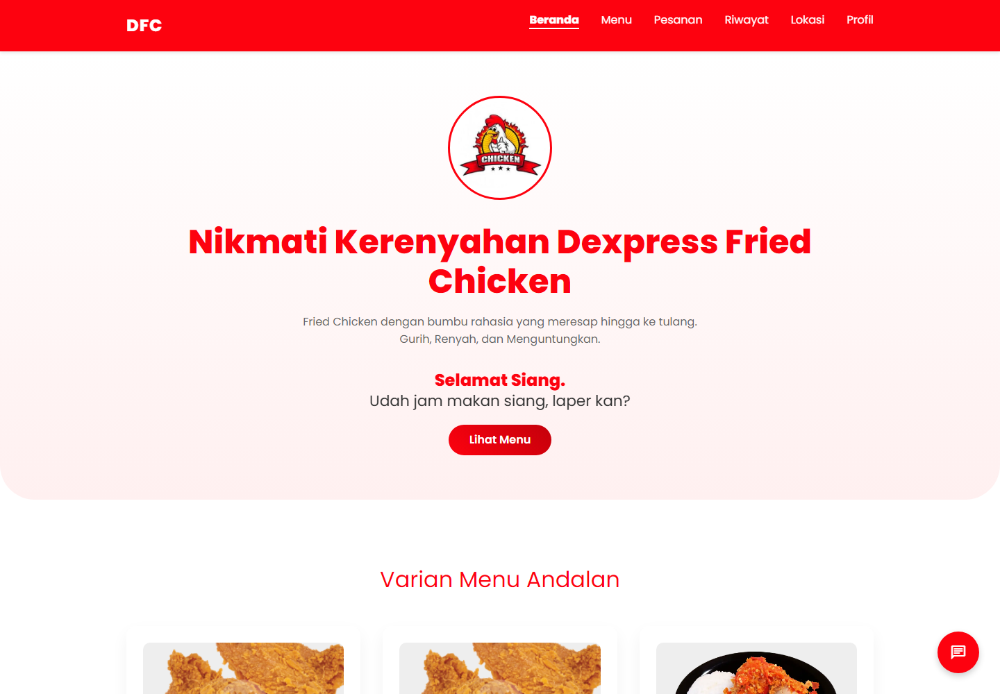 | 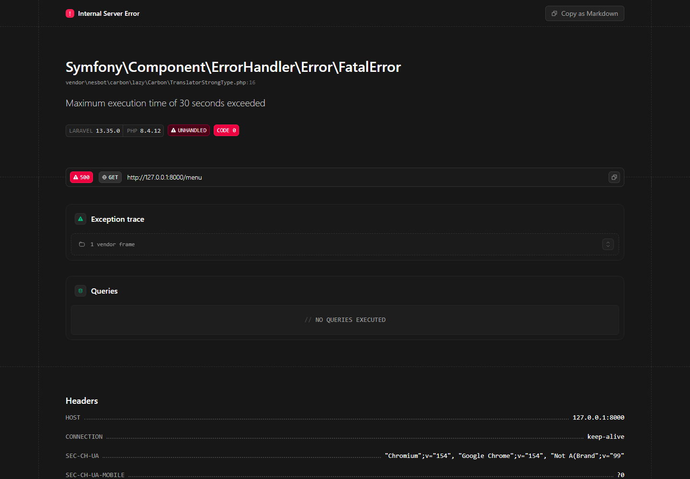 |

| Lokasi Outlet | Profil Perusahaan |
| --- | --- |
| 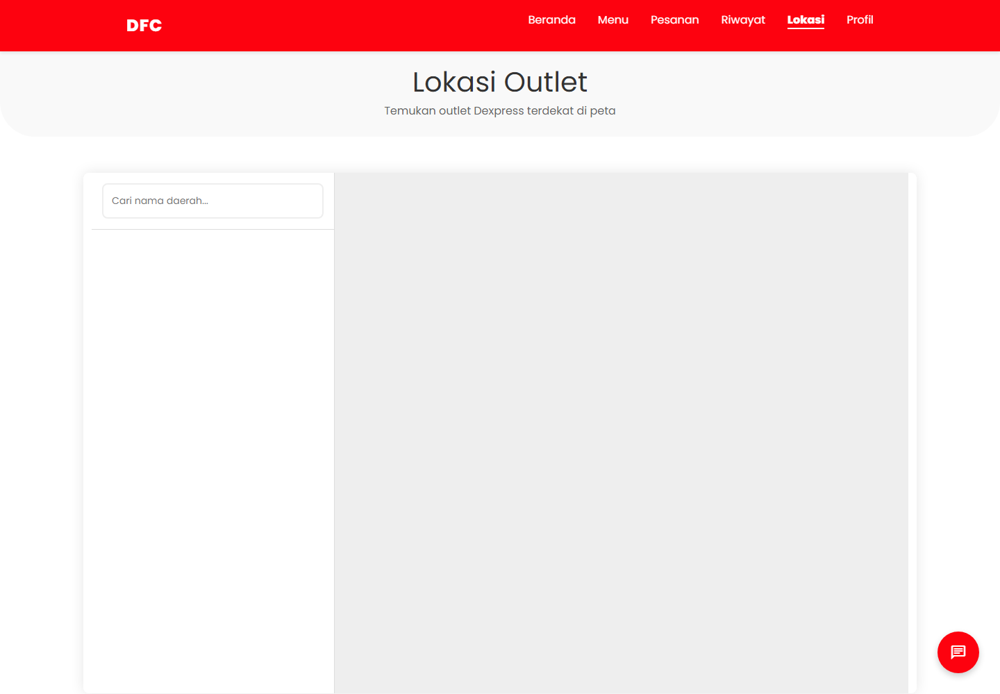 | 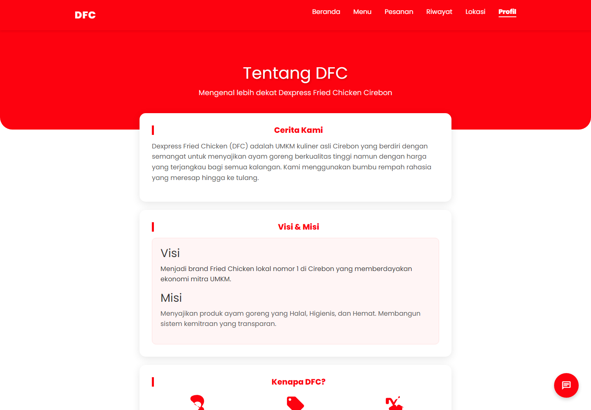 |

| Kemitraan | Pemesanan |
| --- | --- |
| 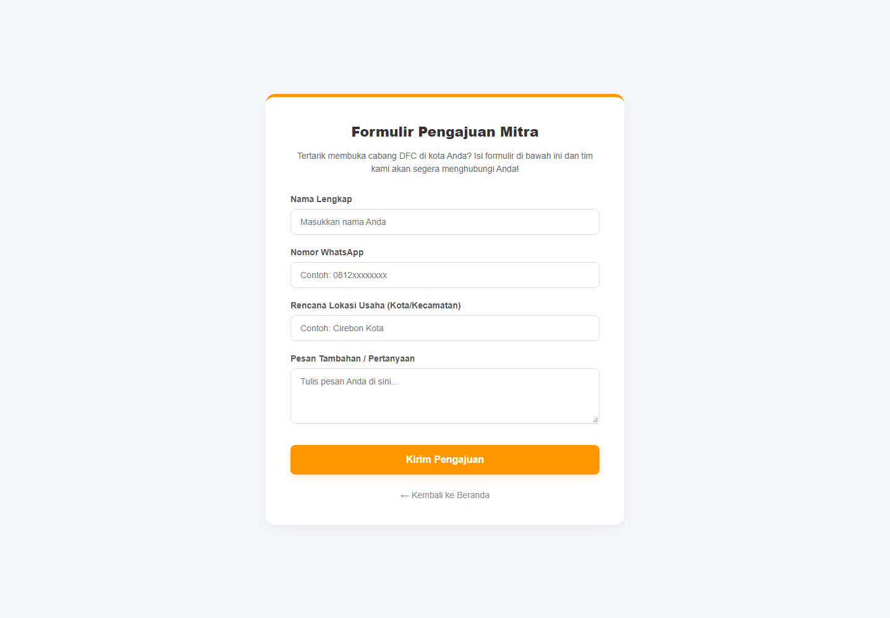 | 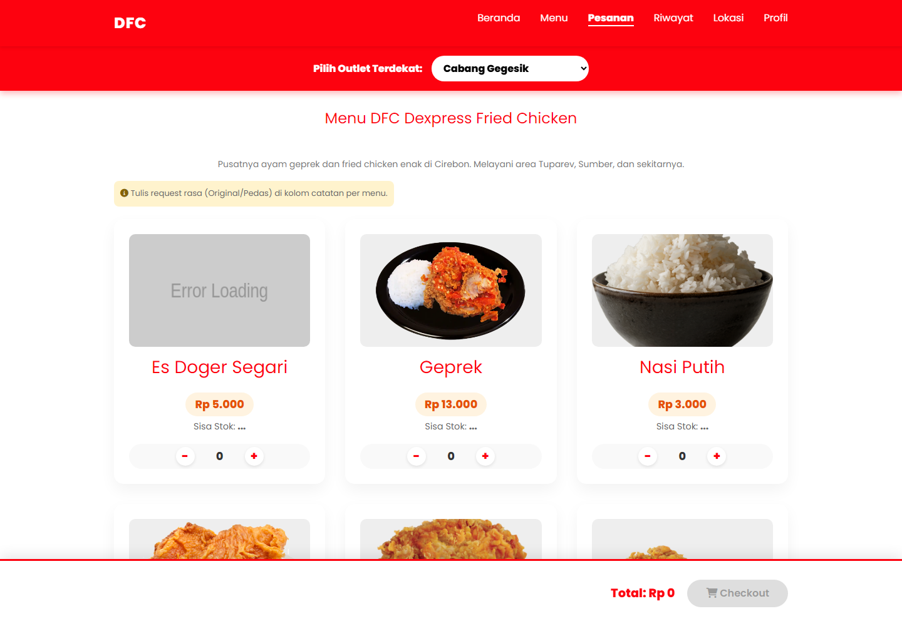 |

| Pelacakan Pesanan |
| --- |
| 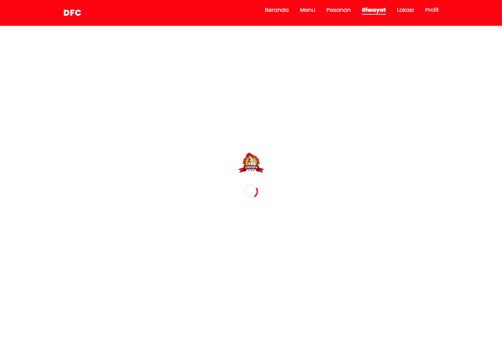 |

### 11.2 Halaman Masuk

| Login Gudang | Login Outlet |
| --- | --- |
| 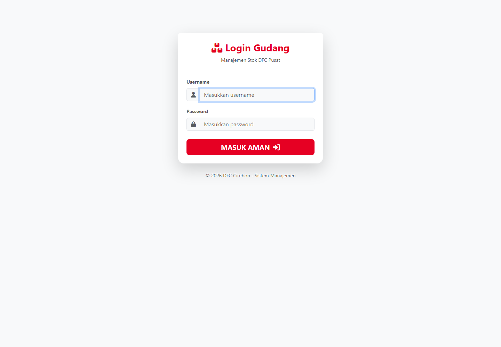 | 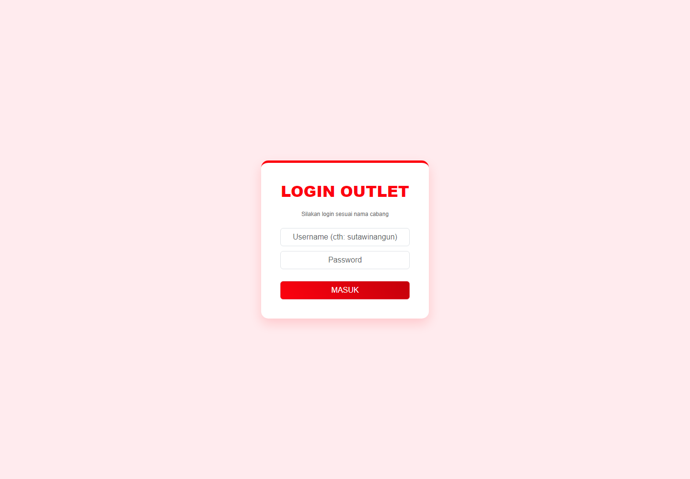 |

| Login Mitra | Login Owner |
| --- | --- |
| 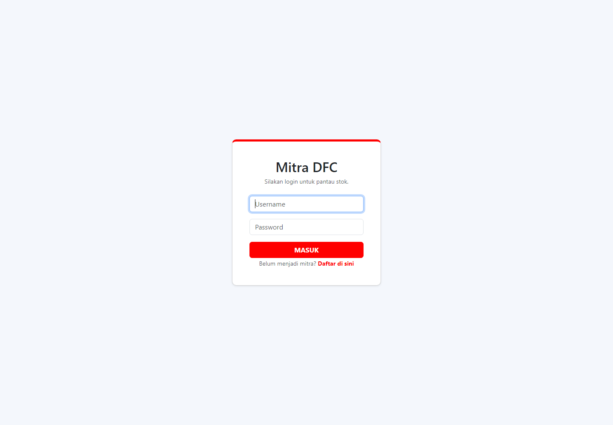 | 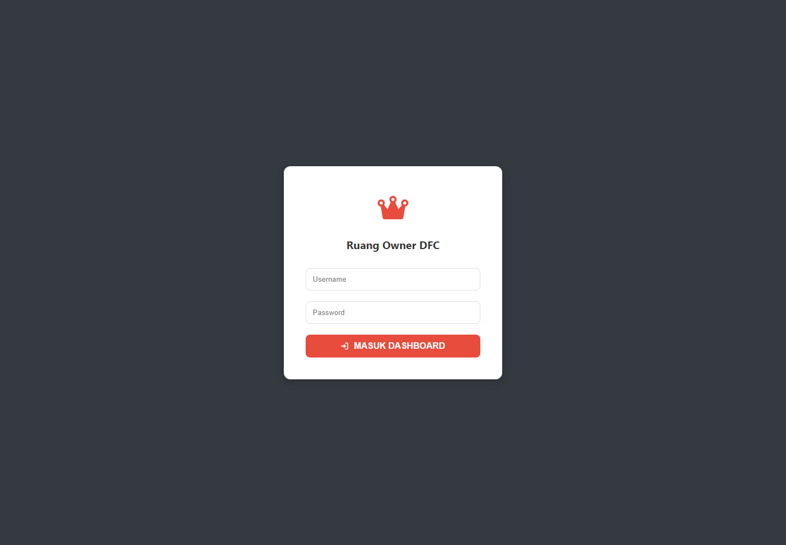 |

### 11.3 Panel Setelah Masuk

| Panel Gudang Pusat | Panel Outlet |
| --- | --- |
| 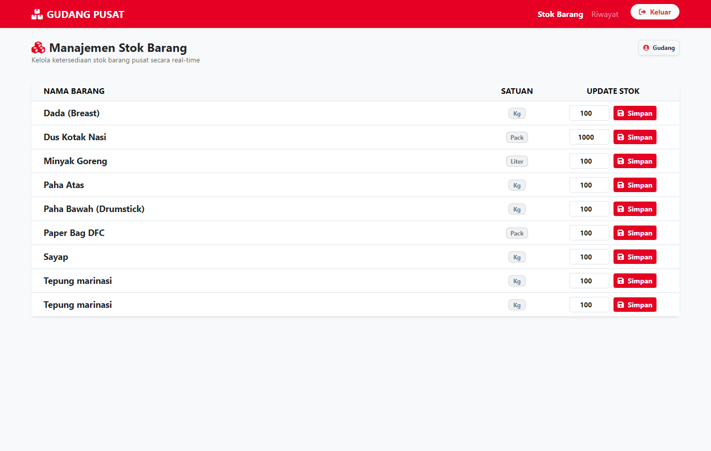 | 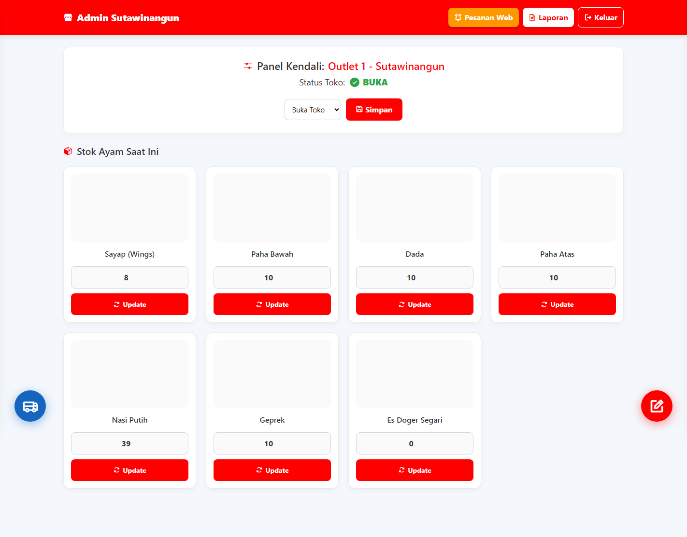 |

| Portal Mitra | Dasbor Owner |
| --- | --- |
| 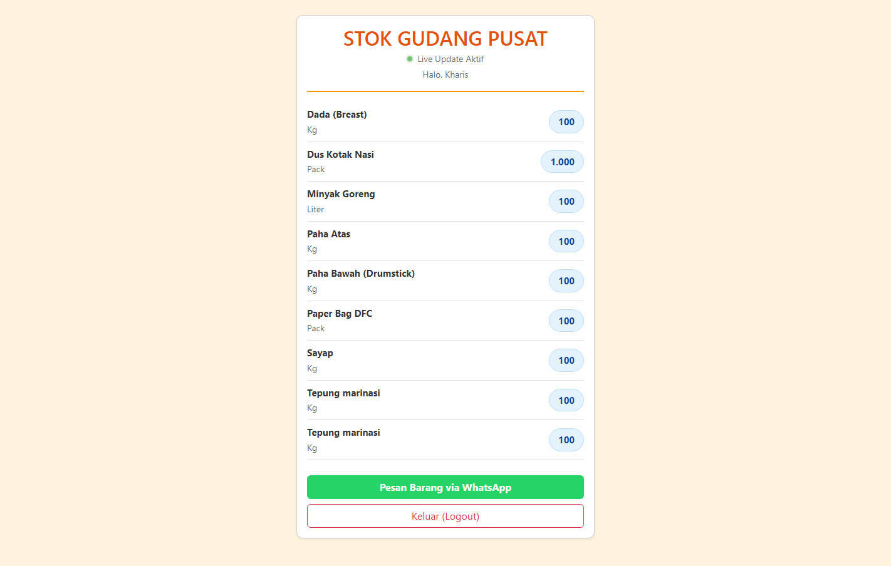 | 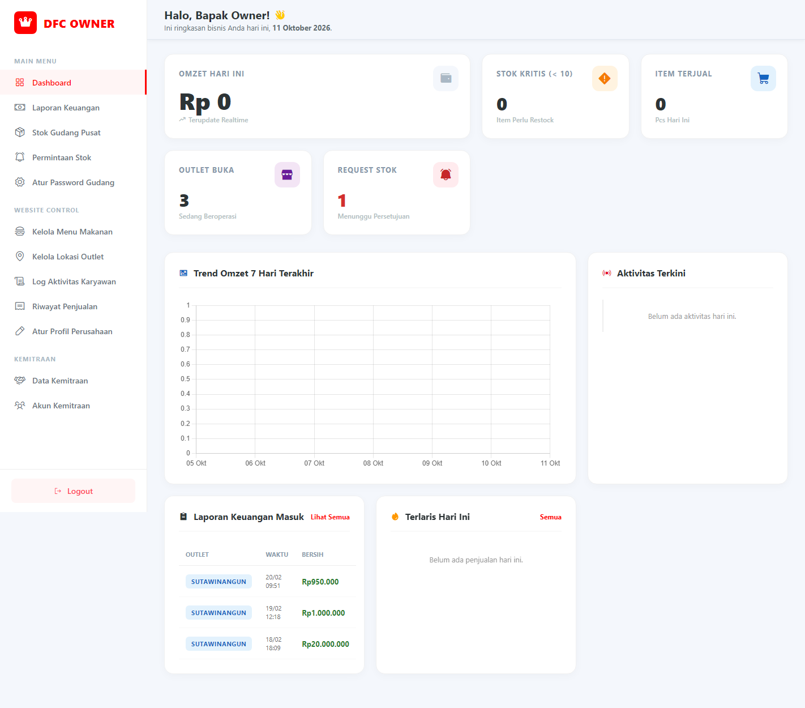 |

---

## 12. Catatan Migrasi dari Native

Aplikasi PHP native tidak dihapus dan tetap tersimpan pada folder
`app/`, `outlet/`, dan `mitra/` di akar repositori. Keberadaannya
dipertahankan sebagai bahan perbandingan dan rujukan untuk memastikan
tidak ada fitur yang tertinggal.

### 12.1 Perubahan Struktur Basis Data

| Aspek | Versi Native | Versi Laravel |
|-------|--------------|---------------|
| Struktur stok | Kolom dinamis stok_username | Tabel terpisah stok_outlet |
| Penambahan outlet | Mengubah struktur tabel | Menambah baris data |
| Query stok | Menyusun nama kolom secara dinamis | Penyaringan biasa |
| Keutuhan data | Tidak terjamin | Dijamin batasan unik dan kunci tamu |

Rincian lengkap perubahan ini dibahas pada bagian 5 dokumen `docs/ERD.md`.

### 12.2 Perubahan Struktur Kode

| Aspek | Versi Native | Versi Laravel |
|-------|--------------|---------------|
| Pola arsitektur | MVC manual | MVC Laravel |
| Akses basis data | Kelas pembungkus PDO | Eloquent ORM |
| Templat tampilan | include berkas PHP | Blade templating |
| Autentikasi | Sesi langsung | Guard Laravel |
| Penjagaan akses | Pemeriksaan di dalam controller | Middleware |
| Validasi | Pemeriksaan manual | Validasi permintaan bawaan |
| Perlindungan CSRF | Tidak ada | Token CSRF pada setiap form |

### 12.3 Pemetaan Berkas Native ke Laravel

Setiap berkas native memiliki padanan pada versi Laravel.
Verifikasi lengkap telah dilakukan dan tercatat pada dokumen SRS
bagian 8 yang memuat matriks ketertelusuran kebutuhan terhadap
controller dan tampilan.

---

## 13. Lisensi

Perangkat lunak ini merupakan hasil kerja sama antara DFC Cirebon
dan Universitas Catur Insan Cendekia. Seluruh hak cipta dilindungi.

| Pihak | Peran |
|-------|-------|
| DFC Cirebon (Dexpress Fried Chicken) | Pemilik sistem usaha |
| Universitas Catur Insan Cendekia | Institusi penyelenggara akademik |

Ketentuan lengkap mengenai hak penggunaan, pembatasan, atribusi,
dan komponen pihak ketiga tercantum pada berkas `LICENSE` di akar
proyek.

Ringkasan ketentuan:

1. Diizinkan memakai, menyalin, dan menyesuaikan untuk keperluan
   operasional DFC Cirebon serta pembelajaran di lingkungan
   Universitas Catur Insan Cendekia.
2. Dilarang menjual atau mengalihkan untuk keuntungan komersial
   tanpa izin tertulis.
3. Setiap penggunaan wajib mencantumkan atribusi kepada DFC Cirebon
   dan Universitas Catur Insan Cendekia.

### 13.1 Penyusun

| Keterangan | Isi |
|-----------|-----|
| Nama | Muhammad Arif Triyana |
| Nomor Induk Mahasiswa | 20251020011 |
| Program Studi | Teknik Informatika |
| Institusi | Universitas Catur Insan Cendekia |
| Tahun | 2026 |
