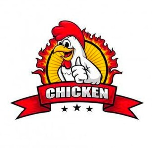

# Dokumentasi Tangkapan Layar

<div align="center">

</div>

Folder ini memuat tangkapan layar resmi aplikasi **DFC Cirebon** versi Laravel
beserta logo perusahaan.

Seluruh tangkapan layar diambil dari aplikasi yang benar-benar berjalan
(`php artisan serve` pada `http://127.0.0.1:8000`) dengan basis data MySQL
`dfc_db` yang sudah diisi **data asli DFC Cirebon** melalui `DataAsliSeeder`.
Tidak ada data contoh yang dibuat-buat.

## Berkas Logo

| Berkas | Keterangan |
| --- | --- |
| `logo-dfc.jpg` | Logo Dexpress Fried Chicken (ayam dengan spanduk CHICKEN) |

## Halaman Publik dan Halaman Login

| Berkas | Halaman | Keterangan |
| --- | --- | --- |
| `01-beranda.png` | Beranda | Halaman utama aplikasi |
| `02-menu.png` | Menu | Daftar menu makanan dan minuman |
| `03-lokasi.png` | Lokasi | Peta dan daftar outlet |
| `04-profil.png` | Profil | Profil perusahaan DFC Cirebon |
| `05-kemitraan.png` | Kemitraan | Informasi kerja sama mitra |
| `06-pesanan.png` | Pesanan | Formulir pemesanan konsumen |
| `07-tracking-riwayat.png` | Tracking dan Riwayat | Pelacakan status pesanan |
| `08-login-gudang.png` | Login Gudang | Halaman masuk admin gudang pusat |
| `09-login-outlet.png` | Login Outlet | Halaman masuk admin outlet |
| `10-login-mitra.png` | Login Mitra | Halaman masuk akun mitra |
| `11-login-owner.png` | Login Owner | Halaman masuk pemilik |

## Halaman Panel Setelah Login

| Berkas | Panel | Akun Uji | Keterangan |
| --- | --- | --- | --- |
| `12-panel-gudang.png` | Panel Gudang | `Gudang` | Manajemen stok barang pusat |
| `13-panel-outlet.png` | Panel Outlet | `sutawinangun` | Panel kendali outlet, stok menu, dan chat pesanan |
| `14-panel-mitra.png` | Panel Mitra | `kharis` | Pemantauan stok gudang pusat untuk mitra |
| `15-panel-owner.png` | Panel Owner | `bigboss` | Dasbor ringkasan bisnis pemilik |

## Cara Mengambil Ulang Tangkapan Layar

### Halaman publik dan halaman login

```bash
bash docs/screenshot/ambil-screenshot.sh
```

Hasil tersimpan di folder sementara. Salin ke folder ini dengan perintah:

```bash
cp /c/Users/riana/AppData/Local/Temp/shots/*.png docs/screenshot/
```

### Halaman panel setelah login

Skrip ini menjalankan alur login sungguhan lewat Chrome DevTools Protocol,
sehingga halaman panel dapat dibuka tanpa campur tangan manual.

```bash
node docs/screenshot/ambil-panel-login.cjs
```

Prasyarat:

1. Server Laravel berjalan pada `http://127.0.0.1:8000`.
2. Basis data `dfc_db` sudah dimigrasi dan diisi data asli.
3. Google Chrome terpasang pada `C:\Program Files\Google\Chrome\Application\chrome.exe`.

## Catatan Keamanan

Akun pada tabel di atas memakai kata sandi hasil pengaturan ulang untuk
keperluan pengembangan dan pengujian, bukan kata sandi produksi. Kredensial
wajib diganti sebelum aplikasi dipakai di lingkungan sungguhan. Daftar lengkap
akun dan kata sandinya tercantum pada bagian 5 berkas `README.md` di akar
proyek.
